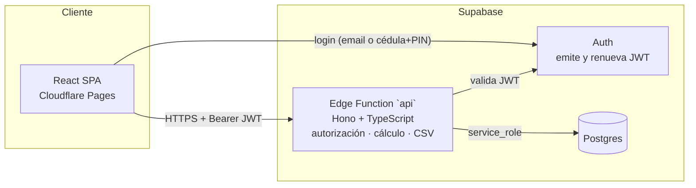

# Marcaje

Cada colaborador marca su entrada y su salida desde el celular. Recursos Humanos ve el estado del día, corrige marcajes (con motivo obligatorio) y obtiene las horas de cada período listas para la nómina, en el CSV que recibe el motor de Kru.

- **App:** [https://marcaje.whady.dev](https://marcaje.whady.dev) 
- **API:** [https://yxkcgjnhngryibaqhidg.supabase.co/functions/v1/api](https://yxkcgjnhngryibaqhidg.supabase.co/functions/v1/api) (`/health` responde sin sesión)
- **Acceso del colaborador:** [https://marcaje.whady.dev/c/EMPRESAA](https://marcaje.whady.dev/c/EMPRESAA) (deja el código de empresa precargado)

### Credenciales de prueba


| Empresa                                        | Rol                      | Acceso                                               |
| ---------------------------------------------- | ------------------------ | ---------------------------------------------------- |
| A · Panadería La Esquina (código `EMPRESAA`)   | RRHH                     | `rrhh@empresa-a.test` / `MarcajeA2026!`              |
| A                                              | Colaboradora (Ana Pérez) | código `EMPRESAA` · cédula `12345678` · PIN `123456` |
| B · Ferretería El Tornillo (código `EMPRESAB`) | RRHH                     | `rrhh@empresa-b.test` / `MarcajeB2026!`              |


Otros colaboradores de A: Luis `20111222`/`222222` (dispara la alerta de horas extra), María `18555666`/`333333` (turnos nocturnos) y Carlos `15999888`/`444444` (dejó una entrada sin salida). Ana tiene cargados los dos turnos de ejemplo del enunciado en la semana **2026-10-05 → 2026-10-11**. Si exportas esa semana, su fila es exactamente `12345678;Ana Pérez;2026-10-05;2026-10-11;2.00;2.50;3.00`.

---

## Correrlo en local

Requisitos: Node 20 o superior y un proyecto de Supabase

```bash
npm install

# 1. Base de datos: aplica la migración al proyecto de Supabase
npx supabase login
npx supabase link --project-ref <ref>
npx supabase db push            # o pega supabase/migrations/*.sql en el SQL Editor

# 2. Variables
cp .env.example .env            # SUPABASE_URL y SUPABASE_SERVICE_ROLE_KEY
cp web/.env.example web/.env    # VITE_SUPABASE_URL, VITE_SUPABASE_ANON_KEY, VITE_API_URL=http://localhost:8787

# 3. Datos de demo
npm run seed

# 4. Levantar (dos terminales)
npm run dev:api                 # http://localhost:8787/api
npm run dev:web                 # http://localhost:5173

# Pruebas y tipos
npm test
npm run typecheck
```

`npm test` corre 97 pruebas. Los dos ejemplos que pide el requerimiento están en `tests/hours.test.ts`, en el bloque "ejemplos del enunciado".

## Arquitectura



```
 Celular / navegador ──login──▶ Supabase Auth  (solo dice QUIÉN eres)
        │
        └──Bearer JWT──▶ Edge Function /api  (decide QUÉ puedes hacer, calcula)
                               │  service_role
                               ▼
                         Postgres (RLS cerrado: el cliente no puede leer nada directo)
```

```
supabase/
  migrations/…_init.sql        esquema, restricciones, funciones transaccionales, RLS
  functions/api/
    index.ts                   entrada Deno (Edge Function)
    app.ts                     rutas Hono (agnóstico al runtime)
    auth.ts                    JWT → actor (admin | colaborador) + empresa
    domain/                    lógica pura, sin I/O, compartida con el cliente
      time.ts  hours.ts  report.ts  csv.ts  periods.ts  day.ts  identity.ts
scripts/dev-server.ts          la misma app sobre Node para desarrollo local
scripts/seed.ts                datos y credenciales de demo
tests/                         pruebas del cálculo (vitest)
web/                           React + Vite
```

## Decisiones importantes y alternativas descartadas


| Decisión                                                                                                                             | Por qué                                                                                                                                                                                                                                                                                                                                                                                                              | Descartado                                                                                                                                                                                             |
| ------------------------------------------------------------------------------------------------------------------------------------ | -------------------------------------------------------------------------------------------------------------------------------------------------------------------------------------------------------------------------------------------------------------------------------------------------------------------------------------------------------------------------------------------------------------------- | ------------------------------------------------------------------------------------------------------------------------------------------------------------------------------------------------------ |
| **Backend propio en una Supabase Edge Function**                                                                                     | El enunciado exige que autorización y cálculo vivan en código propio. Con Edge Functions todo queda en un solo proveedor y un solo despliegue.                                                                                                                                                                                                                                                                       | **Solo RLS + llamadas directas desde el cliente:** no cumple el requisito y deja la lógica de nómina en SQL o en el navegador.                                                                         |
| **Frontend en Cloudflare Pages**                                                                                                     | Es un sitio estático global, el HTTPS y el dominio propio (`whady.dev` ya vive en Cloudflare) son gratis y no tiene arranques en frío.                                                                                                                                                                                                                                                                               | Vercel/Netlify: equivalentes para este caso, pero habría que mover el DNS o delegar el subdominio.                                                                                                     |
| **Colaborador usa código de empresa + cédula + PIN**                                                                                 | En venezuela muchos colaboradores operativos no usan correo, y la cedula ya es su identificador en nomina. El PIN lo genera RRHH y se muestra una sola vez.                                                                                                                                                                                                                                                          | Magic link o correo: fricción y dependencia del correo. Teléfono con OTP: SMS de pago.                                                                                                                 |
| **PIN de 6 dígitos, generado por el servidor**                                                                                       | Se teclea en el celular, a veces con prisa, y se recuerda mejor que una contraseña tras 5 fallos en 15 minutos la cuenta se bloquea otros 15, así que adivinarlo toma años. Lo genera el backend con `crypto.getRandomValues` al dar de alta al colaborador y en cada reinicio (RRHH solo lo recibe y lo entrega), así que no hay fechas de nacimiento ni `123456`. Se muestra una sola vez y no se guarda en claro. | **4 dígitos:** solo 10.000 combinaciones. **Contraseña libre:** se olvida o se repite en otros sitios, y es lenta de teclear en el celular. **PIN elegido por RRHH:** tiende a patrones obvios.        |
| **Código de empresa: 4 letras del nombre + 2 caracteres aleatorios**, creado al registrar la empresa                                 | Es lo que el colaborador escribe junto con su cédula, así que debe ser corto y reconocible. Las 4 letras salen del nombre (sin tildes) y los 2 caracteres aleatorios evitan choques.                                                                                                                                                                                                                                 | **Número secuencial:** se adivina y no dice de qué empresa es. **UUID o texto largo:** inviable de escribir en el celular. **Que lo elija la empresa:** nombres repetidos y choques a resolver a mano. |
| **Marcaje con tipo explícito** (`entrada/salida`) e ID generado en el teléfono                                                       | Un doble toque o un reintento no puede convertir una entrada en salida, y reenviar no duplica.                                                                                                                                                                                                                                                                                                                       | validacion por endpoint.                                                                                                                                                                               |
| **Offline-first solo para el colaborador**                                                                                           | Marcar es lo que no puede esperar a la red. Corregir y exportar sí necesitan los datos del servidor.                                                                                                                                                                                                                                                                                                                 | App nativa: instalación y tiendas para resolver lo mismo. RRHH sin conexión: decisiones sobre datos viejos.                                                                                            |
| **Hora: la del servidor si hay conexión; sin ella, la del teléfono corregida**                                                       | Con conexión el reloj del teléfono no influye. Sin ella se aplica la diferencia medida en la última conexión, y al reconectar se mide de nuevo para detectar cambios de reloj. No es a prueba de fraudes, quien cambie el reloj y lo restaure antes de reconectar no se detecta.                                                                                                                                     | Rechazar marcajes sin conexión.                                                                                                                                                                        |
| React + Vite, CSS propio, sin librería de componentes                                                                                | Un bundle pequeño y control total del diseño mobile-first.                                                                                                                                                                                                                                                                                                                                                           | Next.js (no hace falta SSR), Tailwind/MUI (dependencias para pocas pantallas).                                                                                                                         |
| **Horario esperado solo como aviso**                                                                                                 | Las reglas cuentan la extra desde las 8 h de turno, no según el horario, así que no interviene en el cálculo ni en el CSV. Cada cambio guarda desde cuándo rige, para no reescribir el pasado.                                                                                                                                                                                                                       | Registrar ausencias y retardos como faltas: sin feriados ni permisos daría registros falsos.                                                                                                           |
| **Bloqueo del PIN en nuestro backend:** 5 intentos fallidos en 15 min bloquean 15 min, y el PIN no es la contraseña de Supabase Auth | Con el PIN como contraseña, cualquiera podría probarlo directo contra Supabase. El contador se reserva antes de verificar y va por empresa + cédula, exista o no la persona, así que tampoco revela quién trabaja dónde. Costo: quien conozca una cédula puede bloquear a esa persona 15 minutos; RRHH lo levanta con un PIN nuevo.                                                                                  | Hook de Supabase Auth: solo en planes Teams y Enterprise.                                                                                                                                              |
| **Apariencia de Kru** (violeta, blanco, Inter, bordes finos, etiquetas en mayúsculas)                                                | Marcaje se vende como una extensión de la plataforma de nómina, así que debe sentirse del mismo producto.                                                                                                                                                                                                                                                                                                            | Identidad propia separada.                                                                                                                                                                             |
| **Motivos y turnos con un toque**, sin dejar de exigir el motivo                                                                     | RRHH repite las mismas correcciones. Los chips reducen el tipeo y siguen dejando un texto auditable en la bitácora, que se puede completar a mano.                                                                                                                                                                                                                                                                   | Catálogo cerrado de motivos: no cubre los casos raros y obliga a mantener una tabla.                                                                                                                   |


### Vulnerabilidades cerradas

1. `/register` sin límite. Permitía crear empresas y usuarios en masa. Límite de 5 registros por hora y por IP (`rate_limit_hit`, tabla `rate_limits`). Si no se puede verificar el límite, la solicitud se rechaza.
2. `/pin-requests` sin límite. Permitía inundar el panel de RRHH. Límite de 10 solicitudes cada 10 minutos por IP.

## Qué dejé fuera y por qué

- Geolocalización, foto o QR al marcar para evitar el marcaje de un compañero. Es lo primero que pediría un cliente, pero cada opción tiene un costo en privacidad y en UX que conviene validar con clientes reales.
- Feriados, permisos, almuerzo no remunerado y turnos rotativos. El horario esperado es semanal y fijo, y un feriado aparece como ausencia: por eso es un aviso que no queda registrado como falta.

## Siguientes pasos

1. Bloqueo del período al exportar
2. Registro de foto de perfil
3. Anti-fraude para evitar la manipulación de la hora de entrada o salida
4. Notificaciones
5. Calendario de feriados, permisos y turnos rotativos
6. Metricas detallas en un dashboard para RRHH